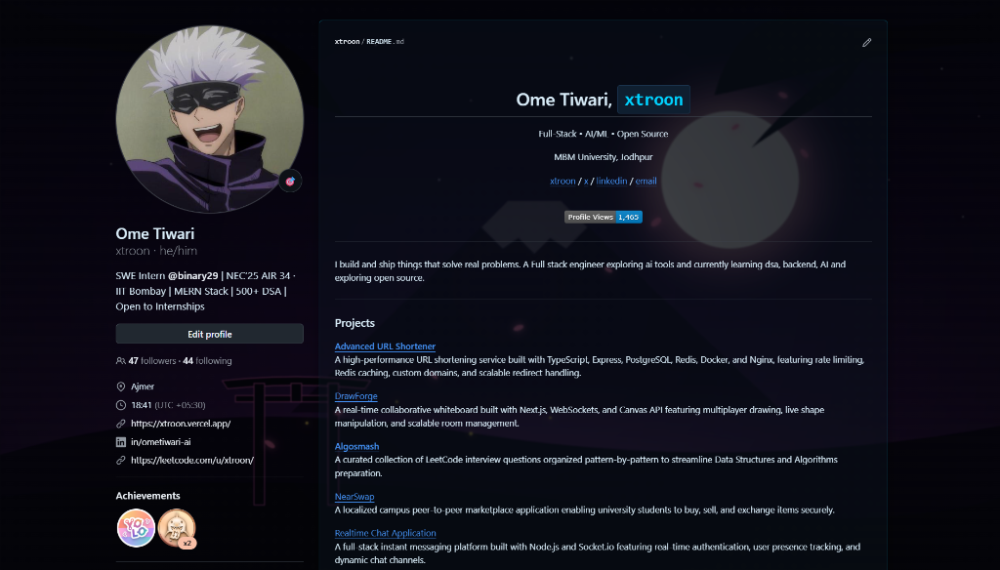
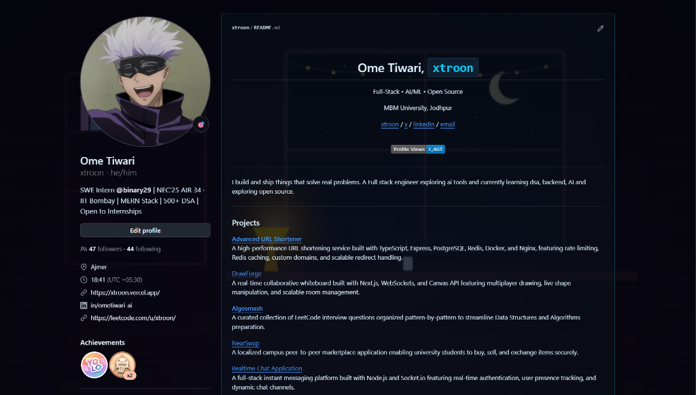
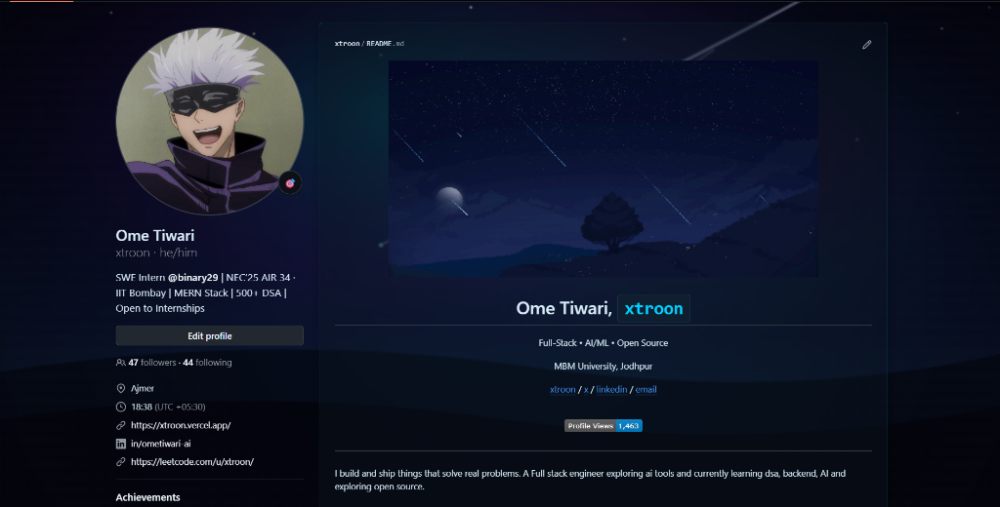
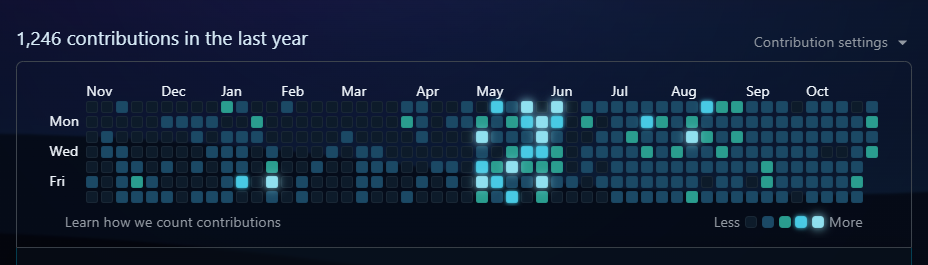
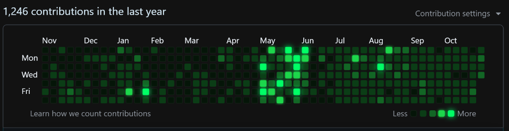
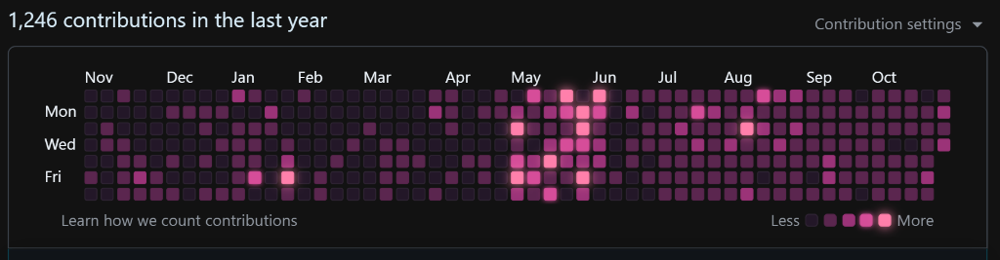
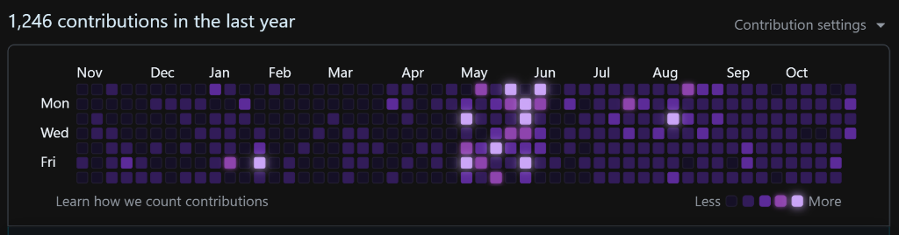
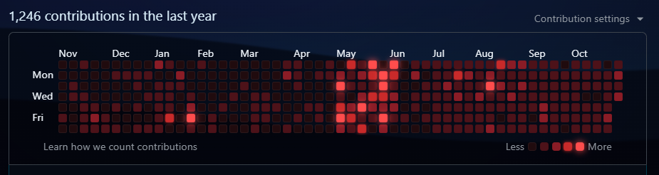

<div align="center">

# Theme Studio for GitHub

**A lightweight browser extension that brings customizable dark themes, code syntax highlighting, frosted glassmorphism, and contribution graph palettes to GitHub.**

[](https://developer.chrome.com/docs/extensions/mv3/intro/)
[](manifest.json)
[](LICENSE)
<!-- [](https://github.com/xtroon/github-theme-extension/stargazers) -->

<br/>



*Theme Studio in action: Frosted glassmorphism profile cards with Sakura Night Shrine wallpaper*

<br/>

</div>

---

## Visual Showcase

### Glassmorphism and Wallpaper Engine

<table>
  <tr>
    <td width="33.3%">
      
      <p align="center"><b>Sakura Night Shrine</b><br/><i>Warm ruby glow with frosted glass cards</i></p>
    </td>
    <td width="33.3%">
      
      <p align="center"><b>Cozy Starry Lofi</b><br/><i>Deep midnight canvas with ambient moonlight</i></p>
    </td>
    <td width="33.3%">
      
      <p align="center"><b>Makoto Starry Sky</b><br/><i>Shooting stars with translucent profile view</i></p>
    </td>
  </tr>
</table>

### Contribution Graph Palettes

Customize your GitHub profile heatmap with vibrant, high-contrast color palettes:

<table>
  <tr>
    <th align="center" width="25%">Palette</th>
    <th align="center" width="75%">Preview</th>
  </tr>
  <tr>
    <td align="center"><b>Electric Glacier</b></td>
    <td></td>
  </tr>
  <tr>
    <td align="center"><b>Matrix Phosphor</b></td>
    <td></td>
  </tr>
  <tr>
    <td align="center"><b>Sakura Petals</b></td>
    <td></td>
  </tr>
  <tr>
    <td align="center"><b>Royal Amethyst</b></td>
    <td></td>
  </tr>
  <tr>
    <td align="center"><b>Crimson Blood</b></td>
    <td></td>
  </tr>
</table>

---

## Features

### Curated Dark and High-Contrast Themes
Includes 12 built-in color schemes calibrated for GitHub's UI components, pull request diffs, and code viewers:
- **Catppuccin Mocha**: Pastel accents on a charcoal lavender canvas.
- **Tokyo Night**: Indigo and electric blue accents inspired by downtown Shibuya.
- **Cyberpunk 2077**: High-contrast yellow, magenta, and cyan accents on deep obsidian.
- **Sakura Blossom**: Soft rose and twilight violet tones.
- **Midnight OLED**: Pure black (`#000000`) surfaces for OLED power efficiency and maximum contrast.
- **Dracula Pro**: Purple, coral, and mint tones on dark slate.
- **Nordic Frost**: Polar night blue-gray palette with arctic cyan accents.
- **Matrix Terminal**: Phosphor green monochrome on an obsidian void.
- **Synthwave '84**: Retro sunset orange and neon violet palette.
- **Vintage Sepia**: Low-contrast warm parchment tones to reduce eye strain during long sessions.
- **Monokai Pro**: Vibrant amber, rose, and sky blue accents on charcoal.
- **Abyss Deep Blue**: Deep oceanic navy with aquamarine highlights.

### Full Code Syntax Highlighting Engine
Custom syntax token recoloring for both GitHub Classic (PrettyLights `.pl-*`) and React Code View (Monaco editor `.mtk*` tokens):
- **Keywords**: Tailored keyword accent colors across all programming languages.
- **Strings and Constants**: Distinct, high-readability tints for string literals, numbers, booleans, and builtins.
- **Entities & Functions**: Clearly differentiated function declarations and class definitions.
- **Comments**: Italicized, subdued tones designed to keep code readable without distraction.
- **Line Numbers & Gutters**: Clean, low-opacity line numbering integrated with the active theme canvas.

### Wallpaper Engine and Glassmorphism
- **14 Built-in Vector Wallpapers**: High-resolution SVGs included locally (Nordic Aurora Fjord, Ghibli Forest Sanctuary, Neo Kowloon Skyline, Dark Topographic Contours, Orion Stellar Nebula, Zen Fuji Sunset, Anime Sunset Lofi, Makoto Starry Sky, Outrun Synth Grid, Cozy Lofi Study, Sakura Night Shrine, Minimal Deep Space, and Rainy City Glass).
- **Custom Image URL**: Point to any remote image URL (Unsplash, personal CDN, direct link).
- **Local File Upload**: Load custom background images directly from your computer, stored locally in `chrome.storage.local`.
- **Glass Blur Slider**: Adjust backdrop filter diffusion from `0px` to `30px`.
- **Surface Opacity Slider**: Fine-tune card and container transparency between `20%` and `100%`.
- **Background Brightness Slider**: Calibrate wallpaper illumination to preserve text contrast.

### Contribution Graph Palettes
Customize the contribution heatmap on GitHub profiles:
- Classic GitHub Green
- Sakura Petals (Pink / Magenta)
- Cyberpunk Neon (Violet to Neon Yellow)
- Solar Flare (Dark Embers to Amber Orange)
- Electric Glacier (Navy to Glowing Ice Cyan)
- Royal Amethyst (Obsidian to Lilac Purple)
- Matrix Phosphor (Black to Green Phosphor)
- Crimson Blood (Dark Crimson to Fiery Red)

### Celebrations
- **Confetti Particle Canvas**: 60fps canvas particle bursts when starring a repository or merging a pull request. Can be toggled on or off from the Preferences tab.

### Focus Mode
Quick toggle via keyboard shortcut (`Alt + Shift + F`) or header button. Instantly hides background artwork and disables backdrop filters for a clean, minimal appearance suitable for screen sharing, meetings, and interviews.

---

## Installation and Setup

### Prerequisites
Any Chromium-based browser supporting Manifest V3:
- Google Chrome
- Brave Browser
- Microsoft Edge
- Arc Browser
- Opera / Vivaldi

### Step-by-Step Setup
1. Clone or download this repository to your machine:
   ```bash
   git clone https://github.com/xtroon/github-theme-extension.git
   ```
   *(Or download the ZIP file and extract it to a local folder).*

2. Open the Extensions management page in your browser:
   - Chrome / Brave: `chrome://extensions`
   - Microsoft Edge: `edge://extensions`
   - Arc: Open Settings > Extensions

3. Toggle on **Developer mode** using the switch in the top-right corner.

4. Click the **Load unpacked** button in the top-left toolbar.

5. Select the root folder of this project (your cloned directory containing `manifest.json`).

6. Open or refresh any page on [github.com](https://github.com). Click the extension icon in your browser toolbar to configure your settings.

---

## Keyboard Shortcuts

| Shortcut | Action | Description |
| :--- | :--- | :--- |
| `Alt + Shift + F` | Toggle Focus Mode | Instantly disables background artwork and blur for clean screen sharing. |

---

## Architecture and Technical Details

- **Manifest V3**: Compliant with modern Chromium extension security standards using a lightweight service worker (`background/background.js`).
- **No Build Tools**: Pure ES6+ JavaScript and Vanilla CSS. No `node_modules`, npm scripts, webpack, or transpilation required.
- **Zero Layout Shift (CLS)**: CSS variables are injected directly into the document root at `document_start` before page rendering begins.
- **Resilient Context Handling**: Content scripts include automatic context validation (`isExtensionAlive`) to prevent crashes or console errors during extension reloads.
- **GitHub SPA / Turbo Compatibility**: Tracks GitHub Turbo / PJAX page transitions to ensure themes, syntax highlighting, and event listeners persist during client-side navigation.

---

## Project Structure

```text
github-theme-extension/
├── assets/
│   ├── screenshots/                 # Preview and demo screenshots
│   └── wallpapers/                  # 14 built-in SVG wallpapers
├── background/
│   └── background.js                # Background service worker (shortcuts & storage)
├── content/
│   ├── confetti.js                  # Canvas particle celebration effects
│   ├── content.js                   # Main DOM observer & event listeners
│   ├── theme-engine.css             # Glassmorphism, syntax highlighting & variables
│   └── themes.js                    # Curated themes & wallpaper definitions
├── icons/                           # Extension toolbar & management icons
├── popup/
│   ├── popup.html                   # Extension popup interface
│   ├── popup.css                    # GitHub Primer Dark stylesheet
│   └── popup.js                     # Dashboard controller & live sync
├── LICENSE                          # MIT License
├── manifest.json                    # Extension Manifest V3 configuration
└── README.md                        # Documentation
```

---

## Show Your Support

If you find Theme Studio for GitHub useful, please consider starring the repository on GitHub.

---

## License

[MIT License](LICENSE). Free for personal and commercial use.
